# caderno-harbour

A Claude Code theme based on [diegorezm.github.io](https://diegorezm.github.io/). It puts the site's hand-drawn night harbour behind the conversation: an axolotl on the quay, a flickering street lamp, drifting water and birds crossing the sky. The colors come from the site too: teal paper with cream ink and lamp amber in dark mode, kraft paper in light mode.

The scene only shows in the Claude desktop and mobile apps. The terminal doesn't draw themes.



## Install

From a shell:

```bash
claude plugin marketplace add diegorezm/caderno-harbour
claude plugin install caderno-harbour@caderno-harbour
```

Or at the prompt of a Claude Code session:

```
/plugin marketplace add diegorezm/caderno-harbour
/plugin install caderno-harbour@caderno-harbour
```

In the desktop app: click + next to the prompt box, then Plugins, Add marketplace with `diegorezm/caderno-harbour`, then Add plugin.
